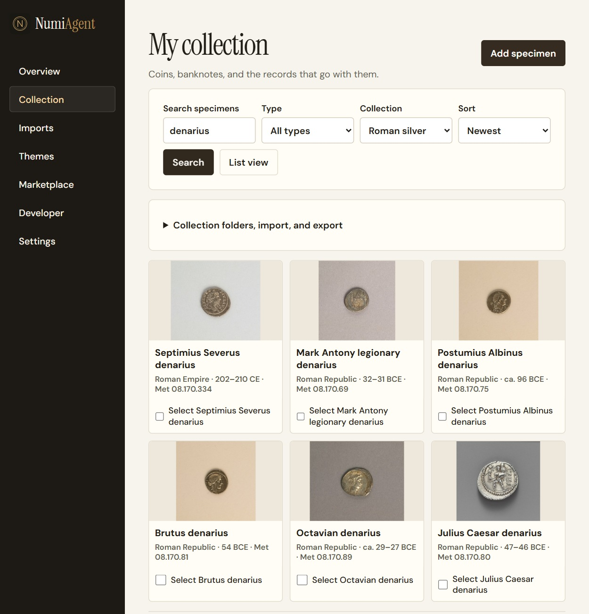
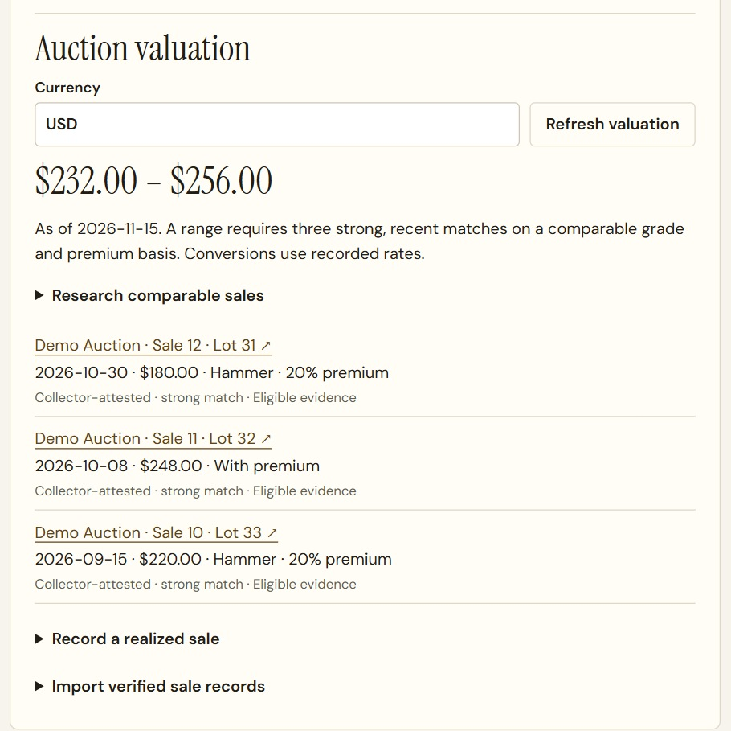

# NumiAgent

**Turn a tray of coins or an album of banknotes into a collection you can search.**

Keep both sides of each piece, the attribution you settled on, and the auction records that support your valuation in one private catalog. See what you own and what you still need before you bid on the next piece.

**[Start your catalog](https://numiagent.com/app)** · [Explore the features](https://numiagent.com/features) · [Read the collector guides](https://numiagent.com/blog)



These screenshots show the running app with a demo collection. Identification scores and sale records are illustrative. [Coin photographs from The Met’s Open Access collection](https://www.metmuseum.org/hubs/open-access).

## From the camera roll to the next coin

### Clear your photo backlog

Upload a batch from your phone or computer and pick up where you left off. Pair obverse and reverse photos, review the crops, and save each piece with its images together. [Read the coin and banknote photography guide](https://numiagent.com/blog/photograph-coins-and-banknotes).

### Identify the pieces you’re stuck on

Opt in to AI-assisted identification for a batch and review suggested attributions, confidence scores, and crops. Check the visible evidence, correct the details, or enter the record by hand. For Roman imperial coins, look up an OCRE type and attach the reference to your specimen. [See how to identify a Roman coin](https://numiagent.com/blog/identify-roman-coins).


### See what comparable pieces sold for

Record realized auction prices alongside the original lot link, date, condition, and currency. Keep the hammer price and buyer’s premium distinct, and look up dated ECB exchange rates when comparing currencies. NumiAgent shows a valuation range when the comparable evidence supports one. [Read the guide to comparing sold lots](https://numiagent.com/blog/compare-coin-auction-prices).



### Know what’s missing from your set

Start with a sourced Roman emperor or Canadian banknote checklist, or define a theme of your own. See which pieces match, which need better references, and which slots remain open. Save auction searches for gaps you want to revisit. Live results and alerts require a configured auction provider. [Build a Roman emperor coin checklist](https://numiagent.com/blog/build-a-roman-emperor-coin-checklist).


## Keep your collection organized and portable

Organize coins and banknotes into folders, filter by attributes, and spot specimens that share a catalog reference. Keep issuer, denomination, grade, provenance notes, and references with each specimen. Export a standard or insurance inventory CSV, download your account data as JSON, or bring in a supported NumisGraph portfolio export. [See the catalog features](https://numiagent.com/features#catalog).

## Connect your own tools

Use a revocable **read-only REST API key** for your scripts or grant a compatible **MCP client** read-only access through OAuth. Connected tools can look up collection records, check theme progress, and read valuation evidence within the access you grant. [Developer docs](https://numiagent.com/developers) · [OpenAPI specification](https://numiagent.com/openapi.json) · [MCP connection guide](https://numiagent.com/developers/mcp).

## Run NumiAgent locally

Use Node.js 24.11 or newer. The Vue app and Hono API run on Cloudflare Workers, with D1 for catalog records and R2 for private images. [Application README](cloudflare/README.md).

```sh
git clone https://github.com/biserd/NumiAgent.git
cd NumiAgent
npm --prefix cloudflare ci
npm run cloudflare:build
npm run cloudflare:db:local
npm run cloudflare:dev
```

Open the local app at `http://127.0.0.1:8787`, enter an email address, and follow the local sign-in link it displays.

- [Cloudflare deployment guide](cloudflare/docs/deploy.md)
- [REST API and MCP integration](cloudflare/docs/api.md)
- [Architecture](cloudflare/docs/architecture.md)

## NumisGraph research app

This repository also contains the original NumisGraph research app, which uses React, Express, PostgreSQL, and Nomisma linked data. Its setup is in [`replit.md`](replit.md). The [integration notes](docs/cloudflare-integration.md) cover migration to NumiAgent.
