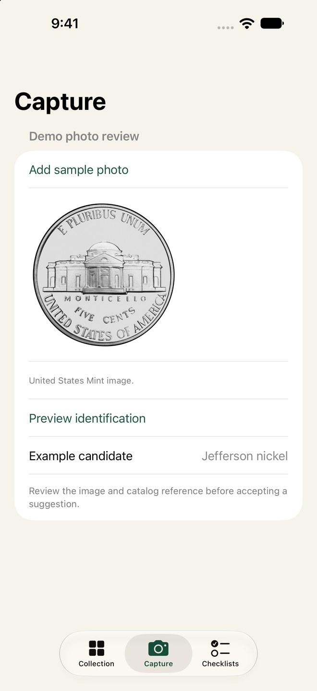
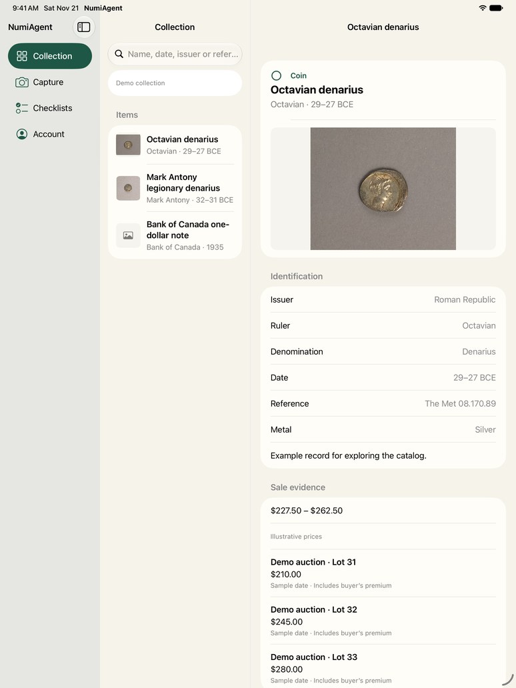
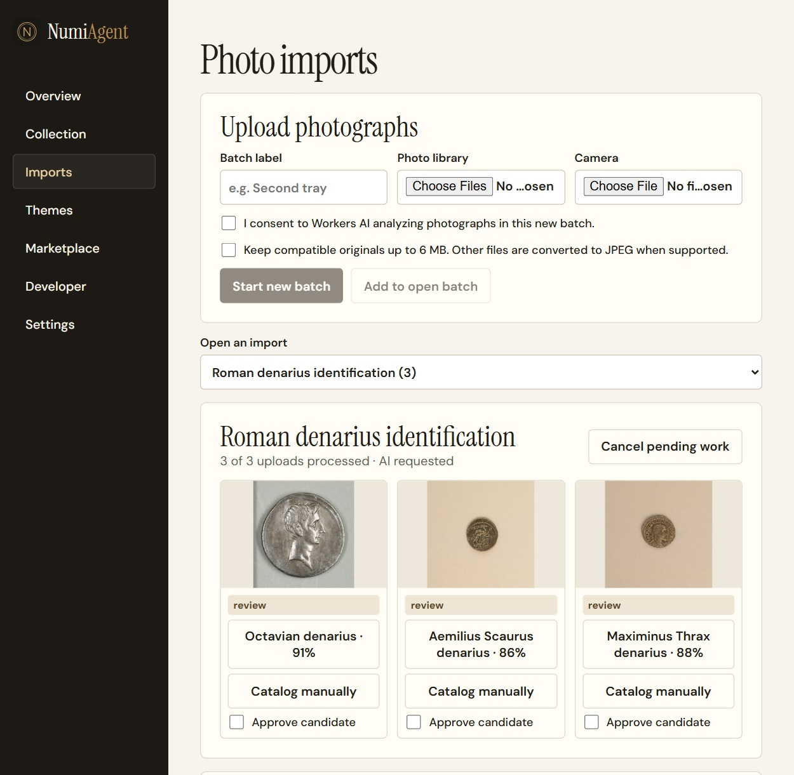
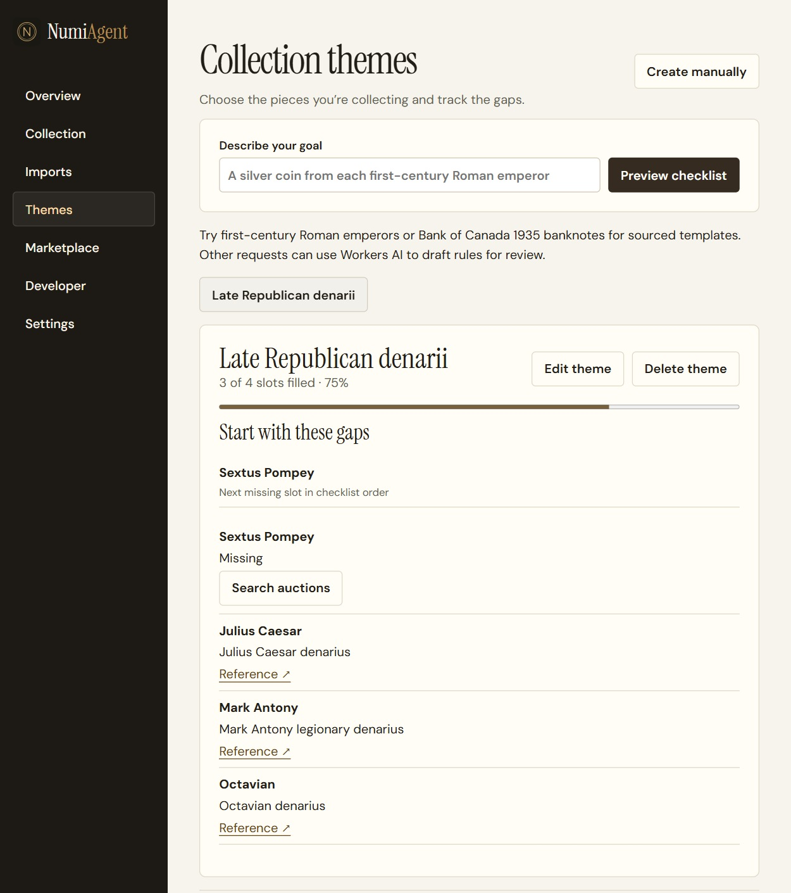

# NumiAgent

**Scan both sides of a coin or banknote. Keep one private record you can find again, even offline.**

NumiAgent is free on iPhone and iPad with iOS or iPadOS 17 or later. Start scanning without an account. When you’re at a coin show and wonder whether you already own that year, search the collection on your device.

[](https://apps.apple.com/app/id6835208218)

[Visit NumiAgent](https://numiagent.com/) · [Open the web catalog](https://numiagent.com/app) · [Read the collector guides](https://numiagent.com/blog) · [Developer docs](https://numiagent.com/developers)

## Catalog your first piece

1. Tap **Start scanning**. Photograph or import either side first, then add the other side to the same record. Your photos and unfinished draft stay on the device when you close the app.
2. Review the details NumiAgent could read offline. Correct a date or denomination, choose a possible match, or leave a field open. If you need help, **Search online** shows which photos you’ll send.
3. Save the piece. Find it again by name, issuer, denomination, or year. On iPad, browse the collection and inspect the selected piece side by side.

| Review a match on iPhone | Browse the collection on iPad |
| --- | --- |
|  |  |

Make an encrypted backup to transfer or restore your local collection, or export a CSV and choose whether to include private fields. Signing in opens your separate account collection. Your guest photos and records stay on your device. [Download for iPhone and iPad](https://apps.apple.com/app/id6835208218) · [Explore the iOS app](https://numiagent.com/coin-collection-app-iphone)

## The web catalog

Use the browser to work through a photo backlog, record the auction evidence behind a valuation, and see what’s missing from a set. [Open the web catalog](https://numiagent.com/app).


The web screenshots show a demo collection with illustrative identification scores and sale records. [Coin photographs from The Met’s Open Access collection](https://www.metmuseum.org/hubs/open-access).

### Clear your photo backlog

Upload a batch from your phone or computer and pick up where you left off. Pair obverse and reverse photos, review the crops, and save each piece with its images together. [Read the coin and banknote photography guide](https://numiagent.com/blog/photograph-coins-and-banknotes).

### Identify the pieces you’re stuck on

Review suggested attributions alongside the photos. Check the visible evidence, correct the details, or save a partial record. For Roman imperial coins, look up an OCRE type and attach the reference to your specimen. [See how to identify a Roman coin](https://numiagent.com/blog/identify-roman-coins).



### See what comparable pieces sold for

Record realized auction prices alongside the original lot link, date, condition, and currency. Keep the hammer price and buyer’s premium distinct, and look up dated ECB exchange rates when comparing currencies. NumiAgent shows a valuation range when the comparable evidence supports one. [Read the guide to comparing sold lots](https://numiagent.com/blog/compare-coin-auction-prices).


### Know what’s missing from your set

Start with a sourced Roman emperor or Canadian banknote checklist, or define a theme of your own. See which pieces match, which need better references, and which slots remain open. Save auction searches for gaps you want to revisit. Live results and alerts require a configured auction provider. [Build a Roman emperor coin checklist](https://numiagent.com/blog/build-a-roman-emperor-coin-checklist).



## Keep your collection organized and portable

Organize coins and banknotes into folders, filter by attributes, and spot specimens that share a catalog reference. Keep issuer, denomination, grade, provenance notes, and references with each specimen. Export a standard or insurance inventory CSV, download your account data as JSON, or bring in a supported NumisGraph portfolio export. [See the catalog features](https://numiagent.com/features#catalog).

## Connect your own tools

Search **70,587 coin and banknote reference entries** by title, issuer, denomination, year, or catalog reference. Inspect the current release to see which sources it covers. [Catalog coverage and source credits](https://numiagent.com/api/v1/catalog).

Use a revocable **read-only REST API key** for scripts or authorize an **MCP client** through OAuth. Both can search the reference catalog and, with your permission, read your account collection, check theme progress, and retrieve recorded sales. [Developer docs](https://numiagent.com/developers) · [OpenAPI specification](https://numiagent.com/openapi.json) · [MCP connection guide](https://numiagent.com/developers/mcp).

## Run NumiAgent locally

For the native SwiftUI app, open the Xcode project and select an iPhone or iPad simulator. [iOS source and setup](ios/README.md).

For the web app, use Node.js 24.11 or newer. The Vue app and Hono API run on Cloudflare Workers, with D1 for catalog records and R2 for private images. [Web application setup](cloudflare/README.md).

```sh
git clone https://github.com/biserd/NumiAgent.git
cd NumiAgent
npm --prefix cloudflare ci
npm run cloudflare:build
npm run cloudflare:db:local
npm run cloudflare:dev
```

Open the local app at `http://127.0.0.1:8787`, enter an email address, and follow the local sign-in link it displays.

- [Cloudflare deployment guide](cloudflare/docs/deploy.md)
- [REST API and MCP integration](cloudflare/docs/api.md)
- [Architecture](cloudflare/docs/architecture.md)

## NumisGraph research app

This repository also contains the original NumisGraph research app, which uses React, Express, PostgreSQL, and Nomisma linked data. Its setup is in [`replit.md`](replit.md). The [integration notes](docs/cloudflare-integration.md) cover migration to NumiAgent.
